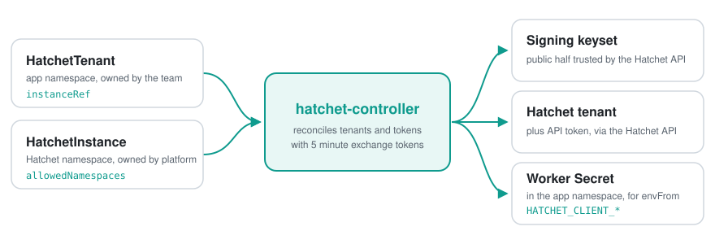

# hatchet-controller

A Kubernetes controller that lets app teams declare a Hatchet tenant in their namespace and receive a ready-to-use worker credential Secret. It manages Hatchet tenants and API tokens as external resources, in the style of External Secrets or a Crossplane provider. It does not install or operate Hatchet.

Two namespaced CRDs in `hatchet-controller.abigroup.io/v1alpha1`:

- `HatchetInstance`: lives in the Hatchet namespace, points at the Hatchet API, names the service user the controller acts as, and decides which namespaces may use it (`allowedNamespaces`, default `Same`). The controller generates the signing keyset for it.
- `HatchetTenant`: lives in an app namespace, references an instance with `instanceRef`, and results in a Hatchet tenant plus a worker Secret (`<name>-hatchet` unless `secretName` is set) with `HATCHET_CLIENT_TOKEN`, `HATCHET_CLIENT_TENANT_ID`, `HATCHET_CLIENT_HOST_PORT`, `HATCHET_CLIENT_SERVER_URL`, `HATCHET_CLIENT_TLS_STRATEGY` and optionally `HATCHET_CLIENT_TLS_ROOT_CA`.

Supported Hatchet versions start at v0.84.0. The controller uses Hatchet control-plane exchange tokens, which are not a documented feature, so pin and test your Hatchet version.

## Why

- **Tenants as code.** A team commits one small `HatchetTenant` next to its workers and gets a working credential Secret. No dashboard clicks, no tokens copied between systems.
- **Topology, not lifecycle.** The controller connects namespaces to an existing Hatchet. Installing and upgrading Hatchet stays with its Helm chart.
- **Split ownership like Gateway API.** The platform team owns the `HatchetInstance` in the Hatchet namespace and decides which namespaces may attach. App teams own their `HatchetTenant`.
- **No long-lived admin credential.** Hatchet API tokens are scoped to one tenant and cannot create tenants. The controller generates its own signing key, Hatchet trusts the public half, and every admin call uses an exchange token that expires after 5 minutes.
- **Plain Kubernetes.** CEL instead of webhooks, owner references instead of cleanup jobs, `Accepted` and `Ready` conditions, and a tenant ID annotation that survives backups and lets you take over existing tenants.

## How it works

<p align="center">
  <picture>
    <source media="(prefers-color-scheme: dark)" srcset="docs/assets/how-it-works-dark.svg">
    
  </picture>
</p>

For each `HatchetInstance`, the controller generates a signing keyset and publishes its public half in the Hatchet namespace, where the Hatchet API reads it at startup. For each `HatchetTenant` it checks that the instance allows the namespace, creates the Hatchet tenant (or binds an existing one), mints an API token and writes the worker Secret. Tokens rotate at two thirds of their lifetime, and deleting the `HatchetTenant` revokes them. Hatchet keeps the tenant, because its API has no delete.

## Install

Use the kustomize remote base. The image tag is set in the base and bumped on every release.

```yaml
resources:
  - github.com/abinnovision/hatchet-controller//config/default?ref=v0.0.0
```

The base installs into `hatchet-controller-system` but does not render the Namespace. Standalone users must create it (Argo CD `CreateNamespace=true`, Flux, or your own Namespace resource) and should apply the `pod-security.kubernetes.io/enforce: restricted` label, which the manager satisfies. To run it next to Hatchet, set `namespace: hatchet` in your kustomization; no Namespace is needed then. The keyset Secret always lives in the Hatchet namespace.

### Optional components

```yaml
components:
  - github.com/abinnovision/hatchet-controller//config/components/networkpolicy?ref=v0.0.0
  - github.com/abinnovision/hatchet-controller//config/components/tenant-id-guard?ref=v0.0.0
```

- `networkpolicy`: grants the controller NetworkPolicy RBAC and enables `--enable-network-policy`, so instances that set `spec.networkPolicy` get an egress policy for worker pods labeled `hatchet-controller.abigroup.io/worker: "true"`. An egress policy isolates the selected pods: they lose all other egress unless other policies allow it. Without the component such tenants report `Ready=False/Forbidden`.
- `tenant-id-guard`: a ValidatingAdmissionPolicy that rejects changing or removing the `tenant-id` annotation once `status.tenantID` is set. The first set, and changes while the tenant is unbound, are allowed. `/status` is not matched. Requires Kubernetes 1.30 or newer.

### Beta releases

Every merge to `main` with unreleased changes publishes a beta image. Stable releases happen when the release PR is merged.

| | Beta | Stable |
| --- | --- | --- |
| Trigger | merge to `main` | merge of the release PR |
| Version | `<next>-beta.<N>`, N counts commits since the last stable release | `<version>` |
| Image tags | `<next>-beta.<N>`, `prerelease-<next>-beta.<N>`, `sha-<short>` | `<version>`, `release-<version>`, `sha-<short>`, `latest` |
| Git tag and GitHub release | none | `v<version>` |
| Image tag in `config/manager` | unchanged | bumped to `<version>` |

Betas have no git tag, so pin the base to the commit the image was built from. The `sha-<short>` image tag names that commit by its first 7 characters. The CRDs come from the base, so keep both at the same commit:

```yaml
resources:
  - github.com/abinnovision/hatchet-controller//config/default?ref=<short>
images:
  - name: ghcr.io/abinnovision/hatchet-controller
    newTag: sha-<short>
```

Betas run the full test suite but may change the `v1alpha1` API without notice. Use them for staging, not production.

## Hatchet wiring

The controller signs short-lived JWTs with a key it generates, and Hatchet must trust the public half. Patch the Hatchet API Deployment (container name depends on your install, see `config/samples/hatchet-api-patch.yaml`):

```yaml
env:
  - {name: SERVER_AUTH_CONTROL_PLANE_EXCHANGE_TOKEN_ENABLED, value: "true"}
  - name: SERVER_AUTH_CONTROL_PLANE_EXCHANGE_TOKEN_JWT_PUBLIC_KEYSET
    valueFrom:
      secretKeyRef: {name: <instance>-exchange-keyset, key: keyset}
  - {name: SERVER_AUTH_CONTROL_PLANE_EXCHANGE_TOKEN_ISSUER, value: hatchet-controller}
  - {name: SERVER_AUTH_CONTROL_PLANE_EXCHANGE_TOKEN_AUDIENCE, value: hatchet}
```

The `secretKeyRef` is not optional, so the API container starts once the controller has created the keyset. Everything can sync together.

The controller acts as an existing Hatchet user. Seed one with `ADMIN_EMAIL=hatchet-controller@<domain>` and a random discarded `ADMIN_PASSWORD`, then drop the password and keep `ADMIN_EMAIL`. Find its UUID:

```sh
psql "$DATABASE_URL" -tAc "SELECT id FROM \"User\" WHERE email='<email>' AND \"deletedAt\" IS NULL"
```

## Quickstart

```yaml
apiVersion: hatchet-controller.abigroup.io/v1alpha1
kind: HatchetInstance
metadata: {name: hatchet, namespace: hatchet}
spec:
  apiURL: http://hatchet-api.hatchet.svc:8080
  serviceUserID: <user uuid>
  worker:
    hostPort: hatchet-engine.hatchet.svc:7070
    tlsStrategy: none
  allowedNamespaces: {from: Selector, selector: {matchLabels: {hatchet-access: "true"}}}
---
apiVersion: hatchet-controller.abigroup.io/v1alpha1
kind: HatchetTenant
metadata: {name: my-app, namespace: my-app}
spec:
  instanceRef: {name: hatchet, namespace: hatchet}
```

Mount the Secret into workers with `envFrom`. Tokens rotate at two thirds of `tokenTTL` (default 720h, minimum 24h). Running workers keep their old token until restarted, so a restarter such as Reloader is recommended. To revoke a leaked token, delete the worker Secret: the controller mints a new one and revokes the old.

## Tenant ID annotation

The annotation `hatchet-controller.abigroup.io/tenant-id` binds a `HatchetTenant` to a Hatchet tenant. After creating the tenant, the controller writes the ID into the annotation, so a restore from a backup that drops status does not create a second tenant. Once bound, a differing value gives `Ready=False/TenantIDConflict` and no action; a removed annotation is restored from status.

### Taking over an existing tenant

Set the annotation before the first apply to inherit an existing tenant instead of creating a new one:

```yaml
apiVersion: hatchet-controller.abigroup.io/v1alpha1
kind: HatchetTenant
metadata:
  name: orders
  namespace: team-orders
  annotations:
    hatchet-controller.abigroup.io/tenant-id: 5f0e2c1a-7b3d-4e8f-9a6b-1c2d3e4f5a6b
spec:
  instanceRef: {name: hatchet, namespace: hatchet}
```

The controller accepts the tenant only if:

- the value is a valid UUID and the service user can read the tenant (it must be a member);
- for a tenant created by this controller (slug `<namespace>.<name>-<uid8>`), the slug's namespace equals the `HatchetTenant`'s namespace.

Tenants created manually in Hatchet can be inherited by any namespace the instance allows, once a Hatchet admin adds the service user as a member. Otherwise the tenant reports `Ready=False/InheritRejected`.

The tenant ID of a controller-created tenant is in `status.tenantID`, the annotation, and the `TenantCreated` event; for manual tenants, take it from the Hatchet UI.

## RBAC

| ClusterRole | Aggregation | Grants |
| --- | --- | --- |
| `hatchet-controller-hatchettenant-editor-role` | admin, edit | manage `hatchettenants` |
| `hatchet-controller-hatchet-viewer-role` | view | read both CRDs |
| `hatchet-controller-hatchetinstance-admin-role` | none | manage `hatchetinstances`; bind it per Hatchet namespace |

Instance admin equals Hatchet root, so it is not aggregated. Wildcard namespace roles, Argo CD AppProjects or Capsule can still grant instance creation.

## Security notes

- The controller has cluster-wide Secret read and write to create worker Secrets in tenant namespaces. It never deletes Secrets. A compromise reaches beyond Hatchet and equals Hatchet admin, so the image is distroless and runs as non-root with a read-only root filesystem.
- The private signing key lives in the Hatchet namespace and can impersonate any Hatchet user. Restrict Secret read there and enable etcd encryption.
- Any allowed namespace can inherit a manual tenant the service user is a member of. Limit `allowedNamespaces` accordingly.
- Limit tenant counts with a ResourceQuota on `count/hatchettenants.hatchet-controller.abigroup.io`.
- Metrics are disabled by default. Enable them with `--metrics-bind-address` and protect the endpoint.
- The DNS egress rule in the generated NetworkPolicy allows port 53 to any destination.
- `spec.apiURL` redirects are not followed.

## Deletion, restore and limits

- Deleting a `HatchetTenant` revokes its tokens and removes the worker Secret. The Hatchet tenant itself is retained, because Hatchet has no tenant delete API.
- Deleting a `HatchetInstance` removes the signing key and keyset. Hatchet blocks on the missing `secretKeyRef` at its next restart until exchange tokens are disabled, and a recreated instance generates a new key that requires an API restart. Tenants then show `Accepted=False/InstanceNotFound`, keep their Secrets until expiry, and release their finalizers without revoking. Guard GitOps-managed instances with `argocd.argoproj.io/sync-options: Delete=false` or `kustomize.toolkit.fluxcd.io/prune: disabled`.
- If the controller is uninstalled while CRs remain, clear finalizers with `kubectl patch <resource> --type merge -p '{"metadata":{"finalizers":null}}'`.
- `RevocationFailed` appears after 10 minutes of failed token revocation.
- Losing namespace consent sets `Accepted=False` but keeps the existing Secret and token.
- Tokens issued before a restore expire naturally.
- Removing `spec.networkPolicy` leaves existing policies in place until the tenant is deleted.
- A failed non-atomic tenant create can leave a tenant without the service user as member. The tenant then reports `SlugTaken`; recreate the CR.
- No Hatchet Cloud support.

## Development

```sh
make build            # generate, manifests, compile
make check            # lint, govulncheck, gofmt, generated files up to date
make test-unit
make test-integration # HATCHET_VERSIONS="v0.84.0 v0.98.12 v0.112.10"
make test-e2e         # needs Docker; uses kind
make docker-build
```
